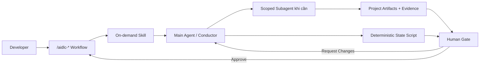

# Hướng dẫn sử dụng AI-DLC Harness trên Antigravity

## Tổng quan



Developer chủ yếu làm việc với main agent thông qua workflows. Main agent chỉ
delegate subagent khi stage graph yêu cầu specialist hoặc independent review.

## Thành phần Antigravity adapter

| Thành phần | Vai trò |
|---|---|
| `.agents/rules/aidlc-core.md` | Invariants áp dụng xuyên suốt lifecycle |
| `.agents/workflows/` | Slash commands developer gọi trực tiếp |
| `.agents/skills/` | Hướng dẫn chi tiết chỉ load khi liên quan |
| `.agents/agents/` | Product, architect, delivery, developer, quality, security và operator subagents |
| `.agents/hooks.json` | Nạp state context, ghi human turn, validate write và force permission review |
| `.agents/scripts/aidlc.mjs` | State machine sở hữu transitions và approval checks |

## Bước 1: Đưa harness vào project

Copy toàn bộ nội dung vào workspace root. Nếu project đã có `.agents/`, merge
từng folder; không overwrite rules, hooks, skills hoặc agents hiện có.

## Bước 2: Mở Antigravity Project

Tạo hoặc mở Project và add repository folder. Project boundary quyết định phạm vi
file agent được truy cập. Không add folder chứa secrets hoặc dữ liệu không liên
quan.

## Bước 3: Kích hoạt rule và kiểm tra hooks

Trong Customizations, xác nhận `aidlc-core` và đặt activation thành **Always On**.
Sau đó chạy:

```text
/hooks
```

Cần thấy `aidlc-session-context`, `aidlc-post-write-guard` và
`aidlc-risk-gate`. `PreInvocation` đọc transcript để ghi hash của human turn mới
và inject state summary; harness không lưu nguyên văn approval prompt.

## Bước 4: Kiểm tra permissions

Trong lần đầu sử dụng, chọn `default/request-review`. Dùng `/permissions` để giữ:

- workspace file access trong project boundary;
- external web/browser actions ở Ask khi chưa tin cậy;
- production, infrastructure, destructive database và external writes ở Ask;
- secret folders và `.git/` ở Deny khi phù hợp.

`risk-gate` chỉ là guard bổ sung, không thay thế permission configuration.

## Bước 5: Validate

```bash
node .agents/scripts/aidlc.mjs validate
node .agents/scripts/smoke-test.mjs
node .agents/scripts/brownfield-smoke-test.mjs
```

Nếu FAIL, sửa harness trước lifecycle work. Không chỉnh `state.json` bằng tay.

## Bước 6: Tạo brief hoặc brainstorm

Chọn lifecycle profile trong `project/brief.md`:

- `greenfield` cho hệ thống mới;
- `brownfield` cho hệ thống đã có source, behavior, consumer, dữ liệu
  hoặc operation cần bảo vệ.

Chỉ Greenfield hoặc một major Brownfield change chưa rõ hướng mới cần brainstorm:

```text
/aidlc-brainstorm <chủ đề ban đầu nếu có>
```

Review `project/idea-notes.md`, chọn direction rồi điền `project/brief.md` với
intent, success measures, constraints, non-goals và known risks.

## Bước 7: Initialize lifecycle

```text
/aidlc-init quan-ly-chi-tieu greenfield
/aidlc-status
/aidlc
```

Intent ID dùng lowercase, số và dấu gạch ngang.

Với project hiện hữu, xem [hướng dẫn Brownfield end-to-end](02-brownfield-end-to-end.md):

```text
/aidlc-init payment-service-onboarding brownfield
/aidlc-baseline
```

Tên intent onboarding không bắt buộc chứa `baseline`; đó chỉ là tên kebab-case để
nhận diện lượt khảo sát project.

Sau khi baseline được duyệt, mỗi bug/CR dùng một intent mới và `/aidlc-change`.
Approval baseline kết thúc intent onboarding; lệnh `init` tiếp theo tạo change
intent, không khởi tạo lại project và không chạy lại baseline.

## Bước 8: Đi qua các stages

Mỗi lần `/aidlc`:

1. state machine xác định directive;
2. main agent load đúng skill và artifacts;
3. stage có `mode: subagent` được delegate cho specialist;
4. artifacts được kiểm tra theo `done_when`;
5. stage có human gate dừng để chờ developer.

Tại gate, trả lời một lượt riêng:

```text
Approve
```

hoặc:

```text
Request Changes: hãy bổ sung rollback requirement và cost constraint.
```

Agent không được gọi `approve` trước một human turn mới. `PreInvocation` hook ghi
nhận lượt này để state machine kiểm chứng thời điểm và decision.

## Bước 9: Implement từng work unit

```text
/aidlc-implement UNIT-001
```

Developer subagent phải:

- chỉ implement một approved unit;
- viết test strategy trước code;
- thêm unit/regression/integration test phù hợp;
- không sửa ngoài scope;
- chạy checks thật;
- ghi `project/evidence/unit-UNIT-001.md`.

Dùng `/agents` để xem subagent đang chạy, inspect result hoặc kill agent bị loop.
Output của subagent không phải approval.

## Bước 10: Verify

```text
/aidlc
/aidlc-verify
```

Review `project/evidence/verification.md` và `project/traceability.md`. `FAIL` và
`BLOCKED` không phải `PASS`. Security subagent được dùng khi có identity,
permissions, secrets, sensitive data hoặc external trust boundary.

## Bước 11: Release

Hoàn thiện `project/operations.md`, để `/aidlc` chọn Release, rồi chạy:

```text
/aidlc-release
```

Lifecycle approval xác nhận kế hoạch. Permission card của Antigravity xác nhận
tool call cụ thể. Developer phải review cả hai. Ưu tiên staging, smoke test và
rollback readiness trước production.

## Resume và recovery

Khi mở conversation mới hoặc context bị compact:

```text
/aidlc-status
/aidlc
```

Nếu workflow parked, xử lý nguyên nhân thật rồi mới resume. Không resume để bỏ
qua test hoặc environment failure.

## Checklist

- [ ] `aidlc-core` là Always On.
- [ ] `/hooks` hiển thị đủ ba hook groups.
- [ ] Permissions giữ external/destructive actions ở Ask hoặc Deny.
- [ ] Harness validation và smoke test PASS.
- [ ] Lifecycle profile đúng với trạng thái project.
- [ ] Brownfield baseline đã được human duyệt trước change work.
- [ ] Brief đủ intent, success measures, constraints và non-goals.
- [ ] State chỉ được thay đổi qua workflows/state script.
- [ ] Mỗi work unit có test strategy và evidence.
- [ ] Human gate và permission prompt được review riêng.
- [ ] Verify evidence được đọc trước Release.
