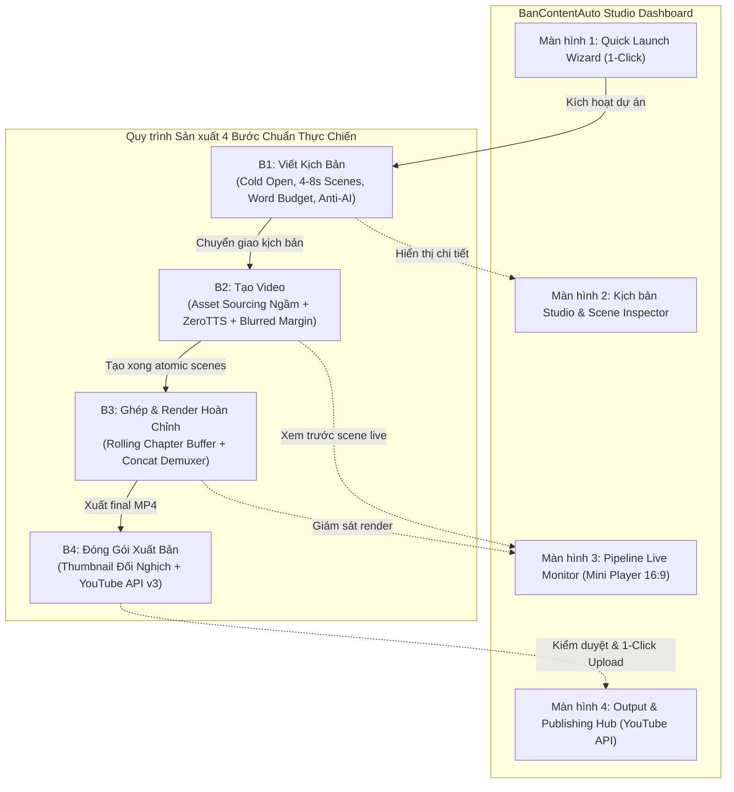
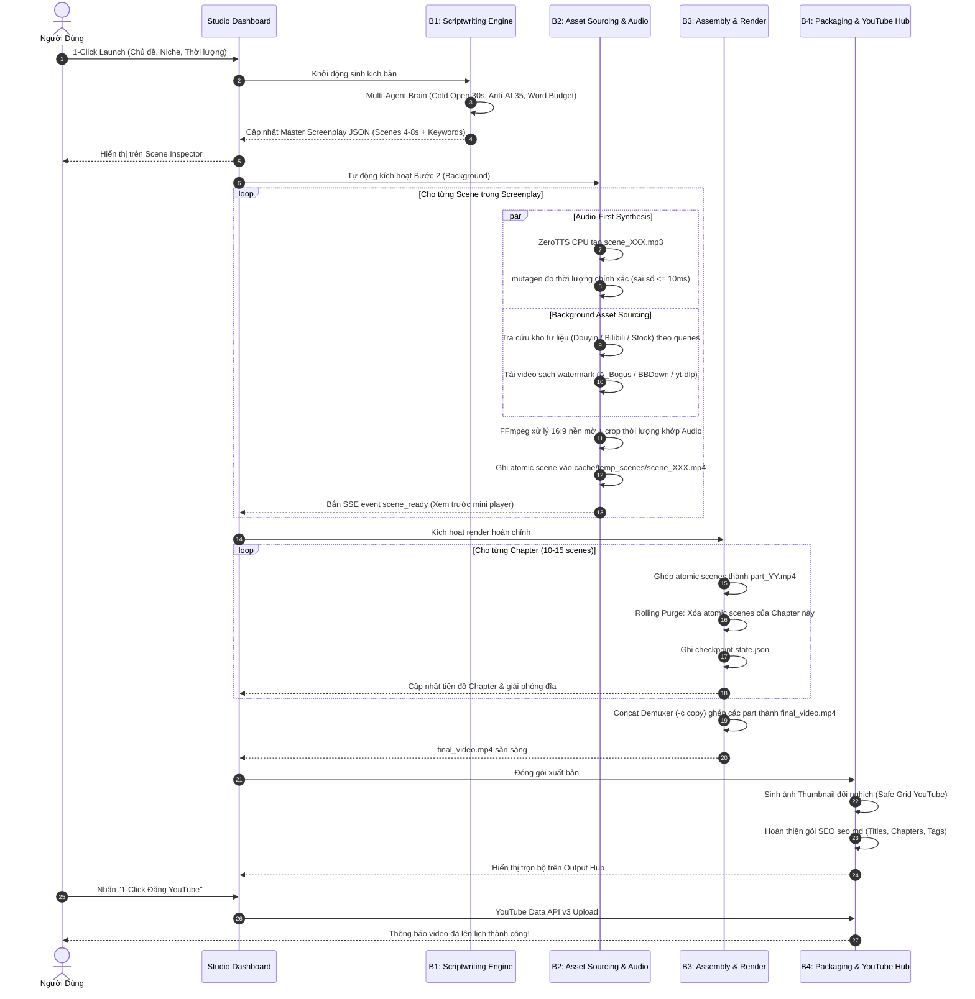
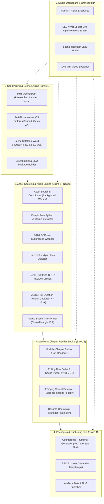
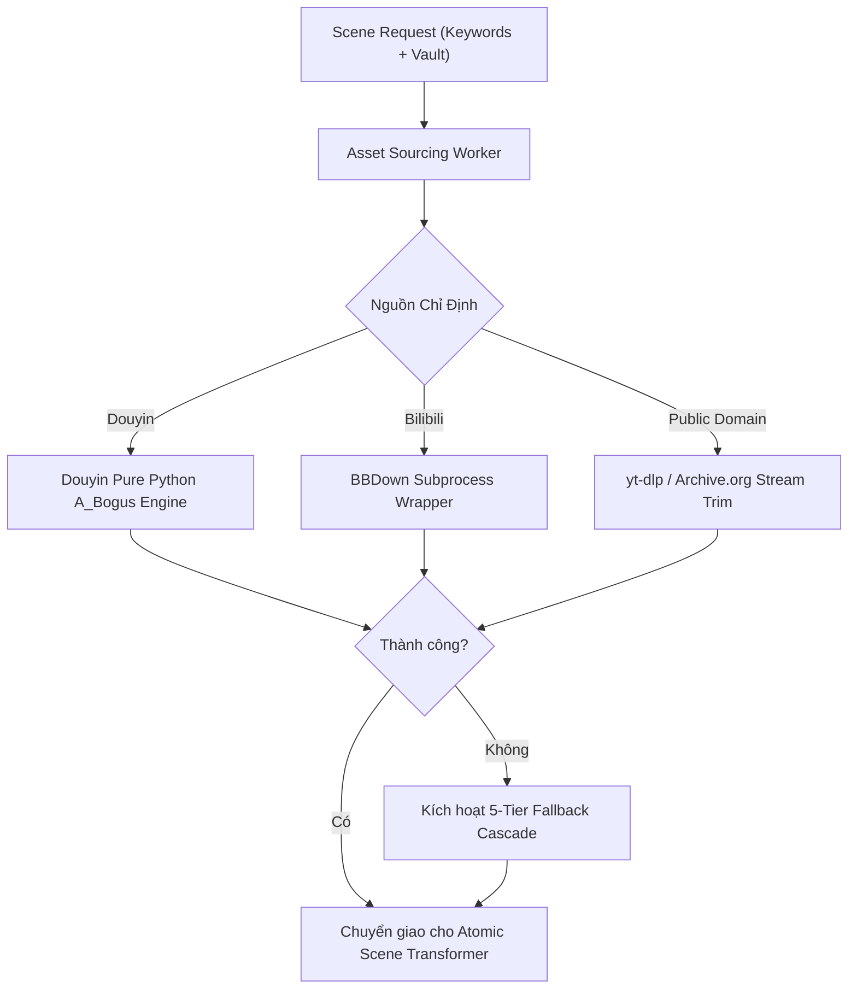
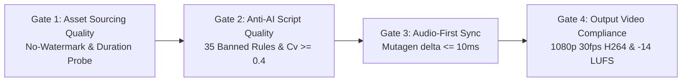

# Architecture: BanContentAuto Studio Dashboard

Status: proposed

## 1. Product/UX design

BanContentAuto là hệ thống tự động hóa sản xuất video YouTube cá nhân trên hệ điều hành Windows, được xây dựng theo triết lý **Script-Driven Automation** và mô hình **Full App Studio Dashboard**:
- **Full App Studio Dashboard (FastAPI Backend + Local Workspace UI)**:
  - Ứng dụng cung cấp bảng điều khiển Studio toàn diện tại `http://127.0.0.1:8000` (kết hợp cửa sổ ứng dụng desktop hoặc trình duyệt).
  - Tích hợp 4 phân hệ màn hình trực quan:
    1. **Màn hình 1 - Quick Launch Wizard**: Khởi tạo dự án 1-Click (nhập chủ đề, chọn niche, thời lượng đích).
    2. **Màn hình 2 - Kịch bản Studio & Scene Inspector**: Bảng phân cảnh 4s–8s, hiển thị chỉ số ngân sách từ vựng (Word Budget Pill), đèn kiểm định Anti-AI 35 patterns, xem trước kịch bản.
    3. **Màn hình 3 - Pipeline Live Monitor**: Thanh tiến độ toàn diện (End-to-End Tracker), mini video player 16:9 xem thử atomic scene thời gian thực kèm audio waveform, đồng hồ đo bộ nhớ đệm đĩa (`Buffer Safe Limit`).
    4. **Màn hình 4 - Output & Publishing Hub**: Xem trước video hoàn chỉnh 1080p, ảnh thumbnail đối nghịch với vùng an toàn YouTube, gói SEO (`seo.md`), và nút 1-Click đăng tải lên YouTube.
- **Quy trình 4 Bước Chuẩn Thực Chiến (4-Step Production Pipeline)**:
  1. **B1: Viết kịch bản & Gói SEO/Thumbnail**: Khởi tạo cốt truyện, Cold Open 30s, chia phân cảnh 4s–8s với ngân sách từ vựng 2.5–3.2 từ/s, sinh gói từ khóa tìm kiếm và concept thumbnail.
  2. **B2: Tạo video (Asset Sourcing Ngầm + TTS + Cắt gọt Scene)**:
     - **Asset Sourcing Engine chạy ngầm 100%**: Không còn màn hình download riêng biệt. Hệ thống tự động truy vấn footage sạch watermark từ Douyin, Bilibili, hoặc Public Domain theo từ khóa của từng scene.
     - **Voiceover Audio-First**: Khởi tạo âm thanh thuyết minh trước bằng ZeroTTS CPU (hoặc MaziaoTTS), đo lường thời lượng chính xác bằng mutagen.
     - **Atomic Scene Transformation**: Tự động chuyển đổi 9:16 sang 16:9 với hiệu ứng nền mờ (Blurred Margin), zoom, slow-motion, ghép âm thanh và video thành các atomic scene chuẩn hóa.
  3. **B3: Ghép & Render video hoàn chỉnh**: Render cuốn chiếu theo từng Chapter (Rolling Disk Buffer $\le 3-5\text{ GB}$) và ghép các part thành `final_video.mp4` bằng FFmpeg Concat Demuxer (`-c copy`) không cần nén lại.
  4. **B4: Tạo ảnh Thumbnails đối nghịch & Xuất bản YouTube**: Tạo ảnh Thumbnail có bố cục tương phản, gói mô tả SEO và hỗ trợ xuất bản tự động qua YouTube Data API v3.
- **Hỗ trợ Interactive CLI / Batch Runner**: Cho phép chạy ngầm hàng loạt từ console qua `python -m autovideo run --config ...` với thanh tiến độ `rich`.



---

## 2. System context and boundaries

Hệ thống vận hành 100% On-Premise trên máy trạm Windows cá nhân của người dùng, không phụ thuộc vào hạ tầng trả phí ($0 Cost Invariant).

```mermaid
flowchart TD
    User([Content Creator / Solo Builder]) -->|Desktop UI / Web Dashboard / CLI| App[BanContentAuto Studio App]

    subgraph App_Internal ["BanContentAuto Core Architecture"]
        Server["FastAPI Backend Server (:8000)<br/>(REST API + SSE Live Events)"]
        Orchestrator["Pipeline Orchestrator & Task Pool"]
        AssetEngine["Asset Sourcing Engine (Background Task)"]
        RenderEngine["Chapter Render Engine (Rolling Buffer)"]
    end

    subgraph External_Platforms ["Nền Tảng Ngoại Vi (External Platforms)"]
        DY["Douyin / TikTok (Web API / CDN)"]
        BI["Bilibili (DASH Streams)"]
        YT["YouTube / Vimeo (yt-dlp extractors)"]
        PD["Public Domain Vaults (Archive.org, Wikimedia, DVIDS, NASA, Pexels)"]
        Gemini["Google Gemini API (2.0 Flash Free Tier)"]
        Maziao["MaziaoTTS API (Cloud Fallback Voice)"]
        YTUpload["YouTube Data API v3 (OAuth2 Publishing)"]
    end

    subgraph Local_Binaries ["Công Cụ Nhị Phân Cục Bộ (bin/)"]
        FFmpegBin["ffmpeg.exe & ffprobe.exe"]
        BBDownBin["BBDown.exe"]
    end

    subgraph Local_Storage ["Hệ Thống Tệp Cục Bộ (Local Filesystem)"]
        Downloads["downloads/ (Cached Sourced Assets)"]
        Cache["cache/ (TTS Audio, Cards, Atomic Scenes)"]
        Renders["renders/ (Parts & Final MP4s)"]
        Config["config/ (Cookies, Prompts, Profiles)"]
    end

    App --> Server
    Server --> Orchestrator
    Orchestrator --> AssetEngine
    Orchestrator --> RenderEngine

    AssetEngine -->|Pure Python A_Bogus + HTTP| DY
    AssetEngine -->|Subprocess Shell| BBDownBin
    BBDownBin -->|Fetch DASH Streams| BI
    AssetEngine -->|Universal Extractor| YT
    AssetEngine -->|HTTP Range Requests| PD

    Orchestrator -->|REST HTTPS (15 RPM Free)| Gemini
    Orchestrator -->|REST HTTPS (Fallback)| Maziao
    Orchestrator -->|OAuth2 Upload| YTUpload
    RenderEngine -->|Subprocess Audio/Video Pipeline| FFmpegBin
    App_Internal <-->|Read / Write / Rolling Purge| Local_Storage
```

### System Boundaries & Guarantees:
- **Tinh giản Downloader**: Không có màn hình tải clip độc lập. Việc tải clip được bao gói hoàn toàn thành **Asset Sourcing Engine chạy ngầm** phục vụ Bước 2 của pipeline.
- **No Redis / No PostgreSQL**: Toàn bộ trạng thái dự án, manifest tư liệu và tiến trình render được lưu trữ trong các file JSON/YAML cục bộ (`state.json`, `manifest.json`).
- **Zero Financial Cost ($0 Invariant)**: Tận dụng Gemini Flash Free Tier, ZeroTTS CPU offline, và kho tư liệu Public Domain / Douyin / Bilibili.
- **Fail-Safe Isolation**: Lỗi từ một nguồn tư liệu ngoại vi không làm gián đoạn pipeline mà được chuyển hướng tự động qua **Chuỗi Dự phòng Thị giác 5 Tầng (5-Tier Fallback Cascade)**.

---

## 3. End-to-End 4-Step Data Flow

Luồng dữ liệu di chuyển mạch lạc qua 4 bước với hợp đồng dữ liệu (data contracts) xác định rõ ràng:



---

## 4. Components and responsibilities

Kiến trúc hệ thống được chia thành 5 phân hệ cốt lõi:



### Chi tiết Trách nhiệm Từng Phân Hệ:

1. **Scriptwriting & Scene Engine (Bước 1)**:
   - Quản lý quy trình sinh kịch bản gồm 7 Agent.
   - Thiết kế Cold Open 30 giây (Cú sốc số liệu $\to$ Đập tan ngộ nhận $\to$ Luận đề mở loop).
   - Kiểm định nghiêm ngặt 35 mẫu sáo rỗng AI và độ biến thiên độ dài câu $C_v \ge 0.4$.
   - Phân bổ kịch bản thành các phân cảnh 4s–8s độc lập có ngân sách từ vựng 2.5–3.2 từ/giây.
   - Trích xuất bộ từ khóa tìm kiếm (tiếng Việt, tiếng Anh, tiếng Trung) cho từng scene.
2. **Asset Sourcing & Audio Engine (Bước 2 - Ngầm)**:
   - **Chạy ngầm hoàn toàn**: Tự động nhận diện từ khóa của từng scene và truy vấn kho tư liệu phù hợp mà không cần người dùng thao tác tải thủ công.
   - Tích hợp module giải mã Douyin `A_Bogus` thuần Python (bóc watermark `/play/`), Bilibili `BBDown.exe`, và `yt-dlp`.
   - Vận hành nguyên tắc **Audio-First**: Sinh audio ZeroTTS trước, đo đạc thời lượng bằng `mutagen`, sau đó căn chỉnh footage co giãn hoặc cắt gọt vừa khít độ dài audio.
   - Chuyển đổi khung hình 9:16 sang 16:9 với hiệu ứng nền mờ (Blurred Margin) và hiệu ứng chuyển động điện ảnh (Ken Burns / Zoom).
   - Xuất atomic scene vào `cache/temp_scenes/scene_XXX.mp4` và phát tín hiệu xem trước lên giao diện người dùng.
3. **Assembly & Chapter Render Engine (Bước 3)**:
   - Chia kịch bản thành các Chapter (mỗi Chapter 10–15 scenes).
   - Render từng Chapter thành `part_YY.mp4` đồng nhất chuẩn: `1920x1080`, `30fps CFR`, codec `H.264 High@L4.1`, âm thanh AAC stereo `192kbps 48kHz`.
   - **Rolling Disk Buffer**: Giải phóng lập tức các atomic scenes sau khi hoàn thành Chapter, đảm bảo dung lượng đĩa trống tiêu hao $\le 3-5\text{ GB}$.
   - Ghép nối các file `part_YY.mp4` thành `final_video.mp4` bằng Concat Demuxer (`-f concat -c copy`) trong $<40$ giây mà không cần nén lại.
   - Ghi nhận checkpoint phục hồi vào `state.json` phục vụ cờ `--resume`.
4. **Packaging & Publishing Hub (Bước 4)**:
   - Tự động sinh ảnh Thumbnail đối nghịch tuân thủ quy tắc thị giác: góc dưới bên phải chừa trống $20\%$ để không bị nhãn thời lượng YouTube che khuất.
   - Xuất file đóng gói `seo.md` chứa 3 phương án tiêu đề đối nghịch, mô tả có sẵn danh sách mốc thời gian chapters, danh sách thẻ tags.
   - Hỗ trợ xuất bản 1-Click lên kênh YouTube của người dùng qua YouTube Data API v3 (OAuth2).
5. **Studio Dashboard & Orchestrator**:
   - Backend FastAPI cung cấp API điều khiển và luồng sự kiện thời gian thực (Server-Sent Events - SSE).
   - Đồng bộ dữ liệu với giao diện: thanh tiến độ End-to-End, Scene Inspector, mini video player phát trực tiếp scene vừa render.

---

## 5. Application and component design

### 1. Asset Sourcing Engine (Kiến trúc Cào Footage Ngầm)
Thay vì là một công cụ độc lập, phân hệ tải tư liệu được tinh giản thành engine ngầm nằm trong namespace `autovideo.sourcing`:
- **Module kiến trúc**: `autovideo.sourcing.pipeline_worker`
- **Luồng xử lý tự động**:
  1. Khi Bước 2 bắt đầu, worker nhận danh sách `scenes` từ kịch bản.
  2. Với mỗi scene, kiểm tra thuộc tính `preferred_vault` và danh sách `queries`:
     - Nếu `preferred_vault == "douyin"`: Gọi `DouyinExtractor` (A_Bogus Pure Python) truy vấn clip sạch không watermark (`/play/`).
     - Nếu `preferred_vault == "bilibili"`: Gọi `BBDownWrapper` bóc tách luồng DASH 1080p.
     - Nếu `preferred_vault == "stock"` hoặc `archive_org`: Gọi `UniversalDownloader` / `ArchiveStreamAdapter`.
  3. Áp dụng **Chuỗi Dự phòng 5 Tầng (5-Tier Fallback Cascade)** nếu nguồn chính không tìm thấy clip phù hợp:
     $\text{Kho chính} \to \text{Kho phụ} \to \text{Wikimedia Still + Ken Burns} \to \text{AI Still + Film Aging} \to \text{Typographic Card (Pillow 1080p)}$.
  4. Lưu trữ tạm tại `cache/raw_assets/` và chuyển ngay cho bộ chuyển đổi atomic scene.



### 2. Scene Inspector & Live Preview Player Architecture
- Khi mỗi atomic scene (`scene_XXX.mp4`) được ghép thành công với file âm thanh tương ứng, hệ thống ghi nhận vào `SceneInspectorStore`.
- Gửi thông điệp sự kiện qua SSE endpoint `/api/pipeline/events`:
  ```json
  {
    "event": "scene_ready",
    "scene_id": 1,
    "status": "completed",
    "word_budget": "normal",
    "duration_s": 4.82,
    "preview_url": "/api/scenes/preview/1",
    "watermark_clean": true
  }
  ```
- Trên giao diện người dùng, mini player 16:9 ngay lập tức tải và hiển thị bản xem trước của scene vừa hoàn thành kèm biểu đồ sóng âm (audio waveform).

---

## 6. API and integration design

### 1. Local REST & SSE Endpoints (FastAPI)

| Method | Endpoint | Description | Request Body / Query | Response / Event |
| :--- | :--- | :--- | :--- | :--- |
| `GET` | `/api/status` | Tình trạng hệ thống, đĩa trống, CPU load | N/A | `SystemStatusResponse` |
| `POST` | `/api/projects` | Tạo dự án mới qua 1-Click Launch Wizard | `CreateProjectRequest` | `ProjectResponse` |
| `POST` | `/api/pipeline/start` | Kích hoạt toàn bộ pipeline (B1 $\to$ B4) hoặc từng bước | `StartPipelineRequest` | `PipelineStatusResponse` |
| `GET` | `/api/pipeline/events` | Luồng SSE phát sự kiện thời gian thực | `project_id` | `text/event-stream` (SSE) |
| `GET` | `/api/scenes/{project_id}` | Lấy danh sách phân cảnh cho Scene Inspector | `project_id` | `List[SceneInspectorItem]` |
| `GET` | `/api/scenes/{project_id}/{scene_id}/preview` | Stream xem trước atomic scene (16:9 MP4) | `project_id`, `scene_id` | `video/mp4` |
| `GET` | `/api/output/{project_id}` | Thông tin sản phẩm cuối: video 1080p, thumb, SEO | `project_id` | `OutputHubResponse` |
| `POST` | `/api/publish/youtube` | 1-Click xuất bản video lên kênh YouTube | `PublishYouTubeRequest` | `PublishStatusResponse` |

### 2. Event Stream Contract (SSE Protocol)
Các sự kiện chính được phát qua `/api/pipeline/events`:
- `pipeline_step_changed`: Chuyển bước (`B1` $\to$ `B2` $\to$ `B3` $\to$ `B4`).
- `script_generated`: Kịch bản B1 hoàn tất, cập nhật Scene Inspector.
- `scene_sourcing`: Đang cào ngầm footage cho `scene_id`.
- `scene_ready`: Atomic scene đã render xong, có thể xem trước.
- `chapter_completed`: Hoàn tất một Chapter trong B3, giải phóng đĩa.
- `pipeline_completed`: Video hoàn tất, chuyển sang màn hình Output Hub.

---

## 7. Data design and lifecycle

### 1. Cấu Trúc Thư Mục Lưu Trữ

```
BanContentAuto/
├── bin/                       # Portable Binaries (ffmpeg.exe, ffprobe.exe, BBDown.exe)
├── config/                    # Cấu hình tĩnh & Cookies
│   ├── settings.yaml          # Cấu hình chung (Concurrency, Paths, Limits)
│   ├── douyin_cookie.yaml     # Cookie phục vụ cào dữ liệu Douyin
│   ├── youtube_oauth.json     # Thông tin xác thực xuất bản YouTube
│   └── prompts/               # System prompts cho 7 Agents kịch bản
├── cache/                     # Vùng Đệm Tạm Thời (Tự động dọn dẹp)
│   ├── audio/                 # Tệp âm thanh thuyết minh từng cảnh (scene_*.mp3)
│   ├── raw_assets/            # Footage thô tải ngầm phục vụ scene
│   └── temp_scenes/           # Atomic scenes 16:9 đã render kèm audio
├── renders/                   # Kho Sản Phẩm Đầu Ra
│   ├── {project_id}/
│   │   ├── screenplay.json    # Master screenplay chi tiết từng scene
│   │   ├── parts/             # File Chapter trung gian (part_01.mp4, part_02.mp4, ...)
│   │   ├── final_video.mp4    # Video hoàn chỉnh 1080p
│   │   ├── thumbnail.jpg      # Ảnh bìa đối nghịch 1280x720
│   │   ├── seo.md             # Bộ đóng gói SEO (Tiêu đề, Chapters, Tags)
│   │   └── state.json         # Checkpoint phục vụ --resume
```

### 2. Vòng Đời Dọn Dẹp Đĩa Cứng (Rolling Disk Buffer)
- Tiêu chí bắt buộc: Dung lượng đĩa tiêu hao trong toàn bộ quá trình render luôn $\le 3-5\text{ GB}$.
- Quy trình giải phóng bộ đệm:
  1. Trong Bước 2: Footage thô sau khi được cắt gọt và chuyển đổi thành atomic scene sẽ được dọn dẹp ngay.
  2. Trong Bước 3: Sau khi Chapter $N$ được render thành `parts/part_0N.mp4`, hệ thống lập tức xóa sạch các atomic scenes thuộc Chapter đó trong `cache/temp_scenes/`.
  3. Khi Concat Demuxer ghép xong `final_video.mp4`, toàn bộ thư mục `parts/` được xóa bỏ nếu cờ `clean_intermediate_parts` được bật.

---

## 8. Data Contracts & Schemas

### 1. Master Screenplay JSON Schema (Cập nhật cho Pipeline 4 Bước)

```json
{
  "$schema": "http://json-schema.org/draft-07/schema#",
  "title": "MasterScreenplay",
  "type": "object",
  "required": ["project_id", "project_title", "target_duration_sec", "chapters", "seo_package"],
  "properties": {
    "project_id": { "type": "string" },
    "project_title": { "type": "string" },
    "niche": { "type": "string" },
    "target_duration_sec": { "type": "integer" },
    "cold_open": {
      "type": "object",
      "required": ["shock_stat_beat", "misconception_beat", "investigative_loop_beat"],
      "properties": {
        "shock_stat_beat": { "type": "string" },
        "misconception_beat": { "type": "string" },
        "investigative_loop_beat": { "type": "string" }
      }
    },
    "seo_package": {
      "type": "object",
      "required": ["counterpoint_titles", "thumbnail_concept", "description_template", "tags"],
      "properties": {
        "counterpoint_titles": { "type": "array", "items": { "type": "string" } },
        "thumbnail_concept": { "type": "string" },
        "description_template": { "type": "string" },
        "tags": { "type": "array", "items": { "type": "string" } }
      }
    },
    "chapters": {
      "type": "array",
      "items": {
        "type": "object",
        "required": ["chapter_id", "chapter_title", "scenes"],
        "properties": {
          "chapter_id": { "type": "integer" },
          "chapter_title": { "type": "string" },
          "scenes": {
            "type": "array",
            "items": {
              "type": "object",
              "required": ["scene_id", "text", "word_count", "queries", "preferred_vault"],
              "properties": {
                "scene_id": { "type": "integer" },
                "text": { "type": "string" },
                "word_count": { "type": "integer" },
                "target_duration_s": { "type": "number" },
                "actual_duration_s": { "type": "number" },
                "queries": { "type": "array", "items": { "type": "string" } },
                "preferred_vault": {
                  "type": "string",
                  "enum": ["douyin", "bilibili", "archive_org", "pexels", "wikimedia", "graphic_card"]
                },
                "transformation": {
                  "type": "object",
                  "properties": {
                    "blurred_margin": { "type": "boolean", "default": true },
                    "zoom_factor": { "type": "number", "default": 1.0 },
                    "slow_motion": { "type": "boolean", "default": false },
                    "pointer_graphic": { "type": "string", "enum": ["none", "red_circle", "red_arrow"] }
                  }
                }
              }
            }
          }
        }
      }
    }
  }
}
```

---

## 9. Failure modes and recovery

| Failure ID | Failure Mode | Root Cause | Impact | Automated Recovery / Mitigation Strategy |
| :--- | :--- | :--- | :--- | :--- |
| **`FAIL-NET-01`** | Douyin HTTP 429 / Captcha | Tải ngầm liên tục; IP bị rate-limit | Tải footage scene thất bại | Kích hoạt Jitter Delay lũy tiến (3s $\to$ 9s). Tự hoán đổi cookie từ `douyin_cookie.yaml`. Nếu vẫn lỗi, chuyển sang Tầng 2 (Bilibili/Stock) của Fallback Cascade. |
| **`FAIL-NET-02`** | Archive.org stream timeout | Mạng chậm, máy chủ phản hồi trễ | FFmpeg bị treo tiến trình trim | Đặt timeout 15s (`-timeout 15000000`). Nếu timeout 2 lần, tự động chuyển sang Tầng 3: Wikimedia Commons High-Res Still + Ken Burns. |
| **`FAIL-TTS-01`** | ZeroTTS CPU out-of-memory | Câu quá dài hoặc tài nguyên RAM hẹp | Không tạo được tệp audio | 1. Tách nhỏ câu theo dấu phẩy/chấm.<br/>2. Chuyển sang MaziaoTTS Cloud Adapter.<br/>3. Nếu mất mạng, kích hoạt fallback Edge-TTS CPU. |
| **`FAIL-VIS-01`** | Không tìm thấy footage trên tất cả kho | Từ khóa quá ngách hoặc không có kết quả | Thiếu tư liệu cho scene | Kích hoạt Tầng 5: **Typographic Card Provider (`graphic_card.py`)**. Tạo thẻ chữ số liệu 1080p bằng Python Pillow, thành công 100%, offline tuyệt đối, $0 chi phí. |
| **`FAIL-RND-01`** | Crash giữa chừng trong quá trình render | Mất điện, tắt ứng dụng đột ngột | Gián đoạn render | Các Chapter đã hoàn thành được lưu trong `state.json`. Khi khởi động lại hoặc gọi `--resume`, hệ thống tiếp tục chính xác từ Chapter dang dở. |

---

## 10. Security and privacy design

1. **Bảo mật Thông tin Xác thực**:
   - Các file nhạy cảm (`config/douyin_cookie.yaml`, `config/youtube_oauth.json`, `.env`) được quản lý trong `.gitignore`.
   - API keys được đọc từ biến môi trường (`GEMINI_API_KEY`, `MAZIAO_API_KEY`).
2. **Quyền riêng tư On-Premise**:
   - Toàn bộ pipeline xử lý cục bộ trên máy trạm Windows của người dùng. Không truyền dữ liệu video/kịch bản lên máy chủ của bên thứ ba ngoại trừ các API LLM/TTS đã cấu hình rõ ràng.
3. **Thực thi Subprocess An toàn**:
   - Tuyệt đối không sử dụng `shell=True` cho các lệnh gọi `ffmpeg.exe` và `BBDown.exe`. Sử dụng mảng đối số có kiểm tra an toàn chuỗi để triệt tiêu nguy cơ Command Injection.

---

## 11. Deployment and infrastructure design

### 1. Đóng Gói Ứng Dụng Độc Lập Portable Windows (`.exe`)
Hệ thống được đóng gói thành một thư mục Portable duy nhất, người dùng chỉ việc giải nén và kích hoạt `BanContentAutoStudio.exe`:

```
BanContentAutoStudio_Portable/
├── BanContentAutoStudio.exe # File thực thi chính (PyInstaller Onedir)
├── bin/
│   ├── ffmpeg.exe           # FFmpeg static build
│   ├── ffprobe.exe          # FFprobe
│   └── BBDown.exe           # Bilibili standalone binary
├── static/                  # Giao diện Studio Web Dashboard (HTML/CSS/JS)
├── config/                  # Cấu hình mặc định & prompts
├── cache/                   # Bộ nhớ đệm tự động dọn
└── renders/                 # Thư mục xuất sản phẩm
```

### 2. PyInstaller Build Automation
```powershell
pyinstaller --onedir `
  --name "BanContentAutoStudio" `
  --console `
  --icon "assets/icon.ico" `
  --collect-all yt_dlp `
  --collect-all uvicorn `
  --collect-all fastapi `
  --add-data "config;config" `
  --add-data "static;static" `
  app.py
```

---

## 12. Observability and operations design

1. **Structured Logging**:
   - Sử dụng thư viện `loguru`, xuất log đồng thời ra console và file xoay vòng `logs/studio_{time}.log` (Rotation: 10MB/file, Retention: 7 ngày).
2. **Real-time Pipeline Tracking (SSE)**:
   - Dashboard nhận cập nhật trạng thái liên tục từng scene qua SSE: tiến trình cào ngầm, tiến độ tạo audio, trạng thái render atomic scene.
3. **Thao tác Vận hành & Phục hồi**:
   - Phục hồi tiến trình: `python app.py render --project-id <id> --resume`
   - Dọn dẹp đĩa cứng: Tự động chạy sau mỗi Chapter hoặc lệnh `python app.py clean --cache-only`.

---

## 13. Test design and quality gates



1. **Gate 1: Asset Sourcing Quality Gate (`test_asset_quality.py`)**:
   - Clip cào ngầm từ Douyin/Bilibili đạt độ phân giải $\ge 720\text{p}$, thời lượng từ 4s–60s, không logo watermark.
2. **Gate 2: Anti-AI Script Quality Gate (`test_script_anti_ai.py`)**:
   - Quét kịch bản B1 đối chiếu danh sách đen 35 patterns của Wikipedia AI Cleanup.
   - Thẩm định hệ số biến thiên nhịp câu $C_v \ge 0.4$.
3. **Gate 3: Audio-First Sync Gate (`test_audio_sync.py`)**:
   - Độ lệch thời lượng giữa file âm thanh ZeroTTS và phân cảnh video $\le 10\text{ms}$.
4. **Gate 4: Output Video Compliance Gate (`test_video_compliance.py`)**:
   - Thẩm định file `final_video.mp4` bằng `ffprobe`:
     - Độ phân giải: $1920 \times 1080$ chuẩn 16:9.
     - Framerate: 30 fps Constant Frame Rate.
     - Codec: H.264 High@L4.1, Pixel Format `yuv420p`.
     - Âm thanh: AAC stereo, bitrate $\ge 192\text{ kbps}$, sampling rate $48\text{ kHz}$.
     - Độ lớn âm thanh: Chuẩn hóa theo tiêu chuẩn YouTube EBU R128 ($-14\text{ LUFS} \pm 1\text{ LUFS}$).

---

## 14. Cost and vendor lock-in

- **Ngân sách cố định ($0 Cost Invariant)**:
  - LLM: Tận dụng Gemini 2.0 Flash Free Tier (15 RPM, 1.500 requests/ngày).
  - TTS: ZeroTTS chạy cục bộ trên CPU máy trạm ($0 chi phí).
  - Footage: Sourcing tự động từ Douyin, Bilibili, và Public Domain hoàn toàn miễn phí.
  - Công cụ: FFmpeg, yt-dlp, BBDown, Python Pillow, OpenCV, FastAPI đều là mã nguồn mở.
- **Khả năng chuyển đổi linh hoạt (Anti-Lock-in)**:
  - Abstract interface `BaseLLMClient` cho phép chuyển đổi sang Ollama (chạy local Qwen 2.5 / Llama 3) hoặc OpenAI/Claude chỉ bằng cách thay đổi cấu hình.

---

## 15. Requirement traceability

| Requirement ID | Tiêu đề Yêu cầu | Thành phần Kiến trúc Hiện thực | Vị trí Trong Tài liệu Thiết kế |
| :--- | :--- | :--- | :--- |
| **`REQ-DL-DY-01`** | Bóc tách Link Douyin & Redirect | `LinkResolver` (HTTP 302/301 follow, regex) | Section 5: Asset Sourcing Engine |
| **`REQ-DL-DY-02`** | Giải mã A_Bogus & Stream Sạch Không Watermark | `ABogusSigner` (pure Python), `StreamExtractor` (`/playwm/` -> `/play/`) | Section 5: Asset Sourcing Engine |
| **`REQ-DL-DY-03`** | Cào Ngầm Theo Phân Cảnh & Bộ Lọc Thời Lượng | `AssetSourcingWorker` (tự động cào ngầm theo scene queries) | Section 4: Components & Section 5 |
| **`REQ-DL-DY-04`** | Quản lý Cookie & Chống Chặn IP / Rate Limit | `douyin_cookie.yaml`, Jitter Delay (1.5-4s), Backoff | Section 9: Failure Modes |
| **`REQ-DL-BI-01`** | Bilibili Engine Tích hợp `bin/BBDown.exe` | `BBDownWrapper` (asyncio subprocess, DASH muxing) | Section 2 & Section 4 |
| **`REQ-DL-UNIV-01`**| Universal yt-dlp & Stock Video / Archive.org | `YtdlpWrapper`, `ArchiveStreamAdapter` (FFmpeg byte-range) | Section 2 & Section 4 |
| **`REQ-SCR-01`** | Multi-Agent Scriptwriting Pipeline (7 Agents) | `ScriptwritingEngine` (Researcher, Architect, Voice, Humanizer, Splitter, Gate, Commentator) | Section 4: Components (Stage 1) |
| **`REQ-SCR-02`** | Công Thức 30 Giây Giữ Chân (Cold Open) | `StoryArchitect` (3 nhịp: Cú sốc số liệu, đập tan ngộ nhận, luận đề mở loop) | Section 4 & Section 8 |
| **`REQ-SCR-03`** | Anti-AI Humanizer 35 Patterns | `AntiAiHumanizer` (Wikipedia AI Cleanup dictionary, $C_v \ge 0.4$) | Section 13: Test Design & Quality Gates |
| **`REQ-SCR-04`** | Định Chuẩn Ngân Sách Từ Vựng (Word Budget) | `SceneSplitter` (2.5 - 3.2 từ/giây, cảnh 4s–8s, câu hoàn chỉnh) | Section 4 & Section 8 |
| **`REQ-TTS-01`** | ZeroTTS Offline CPU Tiếng Việt ($0 chi phí) | `ZeroTTSOfflineAdapter`, `DurationAdapter` (mutagen sub-ms) | Section 4: Components (Stage 2) |
| **`REQ-TTS-02`** | MaziaoTTS API Fallback & SRT Sync | `MaziaoTTSAdapter` (Cloud fallback, auto-sync SRT) | Section 9: Failure Modes |
| **`REQ-VD-01`** | Chuẩn Hóa Khung Hình 16:9 Nền Mờ | `BlurredMarginTransformer` (FFmpeg `boxblur=25:5`, 100% foreground) | Section 4: Components (Stage 2) |
| **`REQ-VD-02`** | Biên Tập Biến Đổi Hợp Pháp (Fair Use) | `TransformativeEditor` (Zoom-in, Slow-mo, Focus pointer) | Section 4: Components (Stage 2) |
| **`REQ-VD-03`** | Rolling Disk Buffer & Concat Demuxer | `ChapterBuilder` (Render per chapter $\le 3-5\text{GB}$, Concat Demuxer `-c copy`) | Section 7: Data Design & Lifecycle |
| **`REQ-PUB-01`** | Luật Đối Nghịch Tiêu Đề - Thumbnail | `MetadataGenerator` (Title lý tính, Thumb cảm xúc chừa góc 20%) | Section 4: Components (Stage 4) |
| **`REQ-PUB-02`** | 1-Click Publish YouTube Hub | `YouTubeUploader` (API v3 / OAuth2 / Output Hub) | Section 4 & Section 6 |
| **`VAC-UI-01`** | Khởi chạy dự án 1-Click Wizard | `QuickLaunchWizard` (không cần vào tab download thủ công) | Section 1: Product/UX Design |
| **`VAC-UI-02`** | Thanh tiến độ End-to-End Tracker | `LivePipelineTracker` (B1 $\to$ B2 $\to$ B3 $\to$ B4) | Section 1 & Section 6 |
| **`VAC-UI-03`** | Bảng phân cảnh Scene Inspector | `SceneInspector` (Word Budget Pill, Live Mini Player 16:9) | Section 1 & Section 5 |
| **`VAC-UI-04`** | Màn hình đóng gói xuất bản đồng bộ | `OutputPublishingHub` (Video 1080p, Thumb, SEO.md) | Section 1 & Section 4 |
| **`NFR-COST-01`** | Chi Phí $0 Tuyệt Đối | Gemini Flash Free + ZeroTTS CPU + Open Source Binaries | Section 14: Cost and Vendor Lock-in |
| **`NFR-PERF-01`** | CPU-Only Friendly & Kiểm Soát Nhiệt | Concurrency control (download=4, render=2), Semaphore throttling | Section 2 & Section 4 |
| **`NFR-REL-01`** | Khả Năng Phục Hồi (Fault Tolerance) | Chapter checkpointing qua `state.json`, cờ `--resume` | Section 7 & Section 9 |
| **`NFR-COMP-01`** | Quy Chuẩn Đầu Ra Đồng Nhất | MP4 H.264 High@L4.1, 1080p 30fps, AAC 192kbps 48kHz, -14 LUFS | Section 13: Test Design & Quality Gates |
