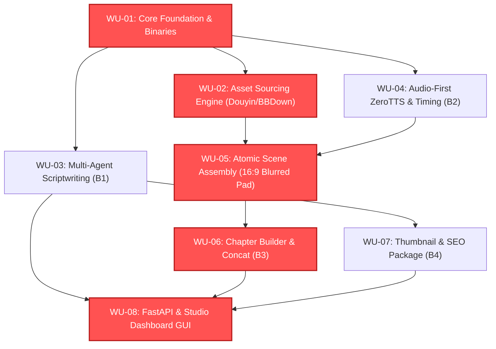

# Work Plan: BanContentAuto (Dual-Mode Video Factory)

Status: proposed

## 1. TỔNG QUAN KẾ HOẠCH & MA TRẬN ĐỘ PHỦ YÊU CẦU

Kế hoạch phân rã công việc (Work Breakdown Structure) được thiết kế theo mô hình các **Đơn vị Công việc Độc lập (Work Units - WU)**. Mỗi Work Unit giải quyết một phạm vi kỹ thuật khép kín, có thể kiểm thử độc lập (independently verifiable), có một rủi ro trọng yếu (dominant risk) và điều kiện hoàn thành đo lường được (done condition).

### Ma trận Độ phủ Yêu cầu (Requirement Traceability Matrix)

| Work Unit ID | Tên Work Unit | Yêu Cầu Đáp Ứng | Yêu Cầu Thị Giác / NFR | Phụ Thuộc |
| :--- | :--- | :--- | :--- | :--- |
| **`WU-01`** | **Core Foundation & Binary Setup** `[COMPLETED]` | `NFR-COST-01`, `NFR-PERF-01`, `NFR-COMP-01` | Structure & bin setup | Không có |
| **`WU-02`** | **Background Asset Sourcing Engine** `[COMPLETED]` | `REQ-B2-01`, `REQ-B2-02` | `VAC-UI-02` | `WU-01` |
| **`WU-03`** | **Multi-Agent Scriptwriting Brain (B1)** `[COMPLETED]` | `REQ-B1-01`, `REQ-B1-02`, `REQ-B1-03`, `REQ-B1-04` | `VAC-UI-03` | `WU-01` |
| **`WU-04`** | **Audio-First ZeroTTS & Mutagen Engine (B2)** `[COMPLETED]` | `REQ-B2-03` | `NFR-COST-01` | `WU-01` |
| **`WU-05`** | **Atomic Scene Assembly & 16:9 Transform (B2)** `[COMPLETED]` | `REQ-B2-04` | `VAC-UI-03` | `WU-02`, `WU-04` |
| **`WU-06`** | **Modular Chapter Builder & Concat Demuxer (B3)** `[COMPLETED]` | `REQ-B3-01`, `REQ-B3-02`, `NFR-REL-01` | `VAC-UI-02` | `WU-05` |
| **`WU-07`** | **Counterpoint Thumbnail & SEO Packager (B4)** `[COMPLETED]` | `REQ-B4-01`, `REQ-B4-02` | `VAC-UI-04` | `WU-03` |
| **`WU-08`** | **FastAPI Server & Studio Dashboard GUI** | `REQ-PUB-02`, Toàn bộ luồng B1 $\to$ B4 | `VAC-UI-01`, `VAC-UI-02`, `VAC-UI-03`, `VAC-UI-04` | `WU-03`, `WU-06`, `WU-07` |

---

## 2. ĐƯỜNG GĂNG TIẾN ĐỘ (CRITICAL PATH) & KHẢ NĂNG SONG SONG

> **Đường găng (Critical Path)**: `WU-01` $\to$ `WU-02` $\to$ `WU-05` $\to$ `WU-06` $\to$ `WU-08`  
> **Nhánh song song an toàn**: `WU-03` (Scriptwriting) và `WU-04` (TTS Engine) có thể phát triển song song ngay sau khi `WU-01` hoàn thành.

---

## 3. CHI TIẾT CÁC WORK UNITS (SPECIFICATION OF WORK UNITS)

### `WU-01`: Core Foundation, External Binaries & File Structure
- **Mục tiêu**: Thiết lập cấu trúc thư mục chuẩn, công cụ quản lý cấu hình, phát hiện và kiểm tra tính sẵn sàng của các file nhị phân trong `bin/` (`ffmpeg.exe`, `ffprobe.exe`, `BBDown.exe`).
- **Phạm vi file**:
  - `src/autovideo/core/config.py`
  - `src/autovideo/core/binary_manager.py`
  - `tests/test_binary_manager.py`
- **Rủi ro trọng yếu (Dominant Risk)**: Môi trường Windows thiếu FFmpeg hoặc PATH không nhận diện được file thực thi dẫn đến crash các tiến trình con.
- **Điều kiện hoàn thành (Done Condition)**: Test chạy tự động phát hiện đúng phiên bản `ffmpeg`, `ffprobe`, `BBDown` trong `bin/` hoặc PATH hệ thống, trả về mã lỗi rõ ràng nếu thiếu.

---

### `WU-02`: Background Asset Sourcing Engine (Douyin & Multi-Platform)
- **Mục tiêu**: Xây dựng module tìm kiếm và cào footage tự động chạy ngầm cho Bước 2. Bẻ khóa chữ ký `A_Bogus` thuần Python (không cần Redis/PostgreSQL), bóc tách link gốc video Douyin không watermark (`/play/`), tích hợp `BBDown` cho Bilibili và `yt-dlp` cho Stock/Pexels.
- **Phạm vi file**:
  - `src/autovideo/sourcing/a_bogus.py` (Thuật toán ký byte `a_bogus` thuần Python)
  - `src/autovideo/sourcing/douyin.py` (Extractor link sạch & API `aweme/detail`)
  - `src/autovideo/sourcing/bilibili.py` (Wrapper BBDown)
  - `src/autovideo/sourcing/engine.py` (Asset Sourcing Dispatcher theo từ khóa scene)
  - `tests/test_douyin_sourcing.py`
- **Rủi ro trọng yếu (Dominant Risk)**: Douyin thay đổi API hoặc chặn IP do cào liên tục mà không có Jitter Delay.
- **Điều kiện hoàn thành (Done Condition)**: Cào thử nghiệm thành công 3 link/từ khóa Douyin, bóc tách ra file MP4 lưu vào `cache/raw_footage/` độ phân giải $\ge 720\text{p}$, kiểm tra bằng hình ảnh không dính watermark Douyin ở 4 góc.

---

### `WU-03`: Multi-Agent Scriptwriting Brain (B1) `[COMPLETED]`
- **Mục tiêu**: Xây dựng bộ máy sinh kịch bản Bước 1 với 7 vai trò chuyên biệt, áp dụng công thức Cold Open 30s, bộ lọc Anti-AI 35 patterns (không sáo rỗng, nhịp câu $C_v \ge 0.4$), bẻ scene 4s–8s (Word Budget 2.5–3.2 từ/s) và xuất `screenplay.json` cùng `seo.md`.
- **Phạm vi file**:
  - `src/autovideo/script/prompts/` (Hệ thống prompt templates cho Persona & Anti-AI)
  - `src/autovideo/script/anti_ai_linter.py` (Kiểm tra 35 patterns & tính toán biến thiên độ dài câu)
  - `src/autovideo/script/word_budget.py` (Tính toán ngân sách từ vựng theo số giây)
  - `src/autovideo/script/pipeline.py` (Điều phối 7 agents qua Gemini Flash / 9router)
  - `tests/test_script_pipeline.py`
- **Rủi ro trọng yếu (Dominant Risk)**: Kịch bản sinh ra bị trượt về giọng điệu chatbot AI thông thường hoặc câu văn vượt quá ngân sách từ vựng gây nuốt chữ.
- **Điều kiện hoàn thành (Done Condition)**: Test tự động sinh một kịch bản 15 cảnh từ chủ đề mẫu, xác nhận: 100% không chứa từ trong danh sách đen, $C_v \ge 0.4$, mọi cảnh có từ vựng nằm trong dải 14–35 từ, xuất đúng schema `screenplay.json` và `seo.md`.

---

### `WU-04`: Audio-First ZeroTTS & Timing Engine (B2) `[COMPLETED]`
- **Mục tiêu**: Xây dựng module tổng hợp âm thanh giọng đọc tiếng Việt qua ZeroTTS (CPU offline, $0 cost) kèm adapter dự phòng MaziaoTTS API. Đo đạc chính xác thời lượng audio bằng `mutagen` với sai số $\le 10\text{ms}$.
- **Phạm vi file**:
  - `src/autovideo/voiceover/zerotts_adapter.py`
  - `src/autovideo/voiceover/maziao_adapter.py`
  - `src/autovideo/voiceover/timing_probe.py` (Đo độ dài sub-ms qua mutagen)
  - `src/autovideo/voiceover/manager.py`
  - `tests/test_voiceover.py`
- **Rủi ro trọng yếu (Dominant Risk)**: ZeroTTS chạy trên CPU bị nghẽn tốc độ hoặc không tương thích môi trường Windows.
- **Điều kiện hoàn thành (Done Condition)**: Tổng hợp thành công 3 câu thoại tiếng Việt, đo được $T_{\text{audio}}$ chính xác lưu vào metadata, file `.wav`/`.mp3` nghe rõ ràng, không giật lag.

---

### `WU-05`: Atomic Scene Assembly & 16:9 Blurred Transformation (B2) `[COMPLETED]`
- **Mục tiêu**: Lắp ráp phân cảnh nguyên tử: tự động cắt gọt footage vừa khít $T_{\text{audio}}$, chuyển đổi clip dọc 9:16 sang ngang 16:9 với hiệu ứng Blurred Background Margin (`boxblur=25:5`), hòa trộn âm thanh hiện trường 30% và xuất ra `cache/temp_scenes/scene_XXX.mp4`.
- **Phạm vi file**:
  - `src/autovideo/production/transformer.py` (Bộ lọc FFmpeg Blurred Margin, Zoom, Slow-motion)
  - `src/autovideo/production/scene_muxer.py` (Mux Video + Audio + SFX)
  - `tests/test_scene_assembly.py`
- **Rủi ro trọng yếu (Dominant Risk)**: Lệch pha âm thanh - hình ảnh (Audio Drift) hoặc FFmpeg filter phức tạp gây lỗi render.
- **Điều kiện hoàn thành (Done Condition)**: Render thành công một atomic scene từ clip dọc Douyin 9:16 + audio ZeroTTS; file đầu ra là MP4 16:9 (1920x1080), hình ảnh khớp từng mili-giây với giọng đọc, nền mờ sắc nét.

---

### `WU-06`: Modular Chapter Builder & Concat Demuxer (B3) `[COMPLETED]`
- **Mục tiêu**: Quản lý dựng video dài (20–30 phút) theo kiến trúc Rolling Disk Buffer (gom 5–10 cảnh thành Chapter, render `part_0X.mp4`, dọn sạch file tạm ngay sau đó để đĩa trống luôn $\le 3–5\text{ GB}$). Ghép nối cuối cùng bằng FFmpeg Concat Demuxer (`-c copy`) trong $<40$ giây. Hỗ trợ phục hồi sự cố qua cờ `--resume`.
- **Phạm vi file**:
  - `src/autovideo/production/chapter_builder.py`
  - `src/autovideo/production/concat_demuxer.py`
  - `src/autovideo/production/rolling_buffer.py`
  - `tests/test_chapter_pipeline.py`
- **Rủi ro trọng yếu (Dominant Risk)**: Lỗi codec mismatch khi Concat Demuxer khiến video thành phẩm bị đen màn hình hoặc mất tiếng ở điểm nối Chapter.
- **Điều kiện hoàn thành (Done Condition)**: Render và ghép nối 3 Chapters mẫu thành video hoàn chỉnh; kiểm tra thời gian concat $<10$ giây, các Chapter nối liền mạch không giật hình, dung lượng đĩa đệm được giải phóng đúng cam kết.

---

### `WU-07`: Counterpoint Thumbnail & SEO Packager (B4) `[COMPLETED]`
- **Mục tiêu**: Xây dựng công cụ tự động tạo ảnh Thumbnail 16:9 có độ tương phản và căng thẳng thị giác cao (chừa vùng an toàn 20% góc dưới bên phải tránh nhãn thời lượng YouTube) và hoàn thiện bộ siêu dữ liệu SEO (Title đối nghịch, Description mốc Chapters, Tags).
- **Phạm vi file**:
  - `src/autovideo/publisher/thumbnail_generator.py` (Pillow / Canvas layout với safe-zone overlay)
  - `src/autovideo/publisher/seo_packager.py`
  - `tests/test_thumbnail_seo.py`
- **Rủi ro trọng yếu (Dominant Risk)**: Chữ hoặc chi tiết quan trọng trên Thumbnail bị nhãn thời lượng video của YouTube che khuất.
- **Điều kiện hoàn thành (Done Condition)**: Sinh ảnh `thumbnail.jpg` 1920x1080 đạt chuẩn kiểm tra tự động: góc dưới bên phải trống hoàn toàn, không lặp lại từ ngữ của Tiêu đề kịch bản.

---

### `WU-08`: FastAPI Server & Studio Dashboard GUI `[COMPLETED]`
- **Mục tiêu**: Xây dựng giao diện Desktop Studio Dashboard chuyên nghiệp và máy chủ điều phối FastAPI: Quick Launch Wizard 1-Click, Live Pipeline Tracker 4 bước (B1 $\to$ B4), Scene Inspector xem trước video/audio trực tiếp, và Output & Publishing Hub.
- **Phạm vi file**:
  - `src/autovideo/api/app.py` (FastAPI REST endpoints & SSE `/api/pipeline/events`)
  - `src/autovideo/ui/` (Giao diện Studio Dashboard trực quan: HTML/JS/CSS Dark Theme hoặc Streamlit/Web UI chuyên dụng)
  - `tests/test_api_endpoints.py`
- **Rủi ro trọng yếu (Dominant Risk)**: Quá trình render nặng làm nghẽn Event Loop của giao diện web khiến người dùng tưởng app bị treo.
- **Điều kiện hoàn thành (Done Condition)**: Khởi chạy ứng dụng bằng 1 lệnh; giao diện mở trên trình duyệt, khởi tạo thành công 1 dự án qua Wizard, thanh tiến trình cập nhật theo thời gian thực (SSE), hiển thị video preview và gói SEO hoàn chỉnh khi kết thúc.

---

## 4. CHIẾN LƯỢC KIỂM THỬ & BẢO ĐẢM CHẤT LƯỢNG (TEST STRATEGY)

1. **Kiểm thử Đơn vị (Unit Tests)**: Từng Work Unit bắt buộc có test suite riêng trong thư mục `tests/`.
2. **Kiểm thử Tích hợp (Integration Tests)**: Xác minh luồng dữ liệu giữa các ranh giới:
   - Script JSON $\to$ Keyword Generator $\to$ Douyin Sourcing.
   - Script Text $\to$ ZeroTTS $\to$ Mutagen Duration $\to$ Scene Assembly.
   - Chapters $\to$ Concat Demuxer $\to$ Final Video.
3. **Kiểm tra Ràng buộc Phần cứng ($0 Cost & CPU Friendliness)**:
   - Đo lường dung lượng đĩa tiêu hao trong suốt quá trình render (đảm bảo luôn dưới ngưỡng 5 GB).
   - Đo mức chiếm dụng CPU khi chạy đa tiến trình (`render_concurrency=2`).
